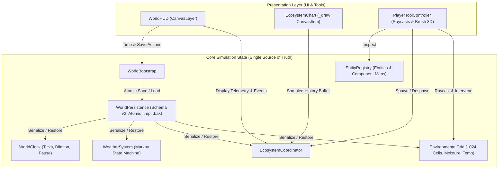

# ARCHITECTURE — Living Planet Sandbox

## 1. Architectural Boundaries & Data Flow

The project follows a strict separation between **Simulation State (Data)** and **Presentation (3D Nodes & Visuals)**.

```
+-------------------------------------------------------------------+
|                        WorldBootstrap                             |
| (Coordinates startup, seeds, clock, persistence, systems)         |
+-------------------------------------------------------------------+
                                  |
         +------------------------+------------------------+
         |                                                 |
         v                                                 v
+-------------------------------+               +---------------------+
|        Simulation Layer       |               |  Presentation Layer |
|  - WorldClock (Tick rates)    |               |  - Terrain (GPU)    |
|  - WorldSeed (PRNG streams)   |               |  - Sky/DayNight     |
|  - EntityRegistry (Sim data)  |               |  - Water Mesh/Shader|
|  - SimulationScheduler        |               |  - Camera Controller|
|  - EnvironmentalGrid (M/T)    |               |  - Entity Views(LOD)|
+-------------------------------+               +---------------------+
         |                                                 ^
         |                    WorldEventBus                |
         +-------------------------------------------------+
         (Dispatches typed state changes without direct coupling)
```

## 2. Core Contracts

### `WorldSeed` (`res://core/seed/world_seed.gd`)
- Encapsulates reproducible PRNG generation.
- Generates dedicated child streams (terrain noise, flora placement, entity RNG) to guarantee determinism regardless of invocation order.

### `WorldClock` (`res://core/clock/world_clock.gd`)
- Governs simulation time independent of render frame rate (`process_delta`).
- Supports time scale acceleration (1x, 2x, 5x), pause, resume, and fixed simulation ticks.

### `WorldEventBus` (`res://core/events/world_event_bus.gd`)
- Central pub/sub broker for typed simulation and environmental events.
- Decouples simulation logic from audio, UI alerts, and visual effects.

### `EntityRegistry` (`res://core/registry/entity_registry.gd`)
- Tracks living simulation entities by unique ID (`entity_id`).
- Stores data components (type, position, health, energy, age, tags).
- Does not instantiate a 3D Node for distant or non-rendered entities.

### `SimulationScheduler` (`res://core/scheduler/simulation_scheduler.gd`)
- Runs fixed-frequency updates for vegetation growth, environmental diffusion, and fauna AI.
- Enforces execution budgets per frame to protect Intel Iris Xe frame rates.

### `WorldPersistence` (`res://core/persistence/world_persistence.gd`)
- Atomic save/load pipeline with schema versioning.
- Writes to temp file first before promoting to slot (`.bak` fallback), ensuring crash-safety.

### `PerformanceMonitor` & `DebugOverlay` (`res://core/debug/`)
- Measures actual runtime FPS, frame time, tick rate, simulated entity count, and rendered node count.
- Exposes developer interventions (pause, time warp, moisture adjust).

### `WorldGenerationConfig` (`res://core/environment/world_generation_config.gd`)
- Pure data resource specifying procedural island parameters (`island_size`, `resolution`, `max_height`, `water_level`, `roughness`, `vegetation_density`, `base_temperature`, `base_moisture`, `lapse_rate`).
- Provides strict clamping, validation, and dictionary serialization for save states.

### `EnvironmentalGrid` (`res://core/environment/environmental_grid.gd`)
- 2D macro grid (default 32x32, 5m cells) tracking continuous environmental fields:
  - `temperature` (°C, adjusted by elevation lapse rate -6.5°C/km and diurnal solar swing ±5.5°C).
  - `moisture` (0.0 to 1.0, modulated by precipitation, evaporation, and proximity to ocean).
  - `water_availability` (ground saturation factoring ocean capillarity and elevation).
  - `sun_exposure` (cosine solar angle attenuated by weather cloud cover).
- Macro simulation tick at 2Hz updates cells without taxing frame rendering.

### `BiomeClassifier` (`res://core/environment/biome_classifier.gd`)
- Whittaker-inspired ecological classification into 7 distinct biomes:
  - `OCEAN`, `COASTAL_BEACH`, `WETLAND`, `TEMPERATE_MEADOW`, `BOREAL_FOREST`, `ALPINE_SUMMIT`, `ARID_SHRUBLAND`.
  - Fully explainable rationale string (`explain_biome`) and standardized color mapping for vertex shaders and UI.

### `WeatherSystem` (`res://core/environment/weather_system.gd`)
- Probabilistic Markov state machine managing weather transitions:
  - States: `CLEAR`, `CLOUDY`, `RAIN`, `DROUGHT`.
  - Driven by dedicated PRNG stream `weather` in `WorldSeed`.
  - Broadcasts `weather_changed` events via `WorldEventBus`.
  - Modulates global solar attenuation, temperature offsets, and precipitation rates.

### `FloraSimulation` (`res://core/ecosystem/flora_simulation.gd`)
- Governs plant life cycle (`SEED`, `SPROUT`, `GROWING`, `MATURE`, `DECAYING`, `DEAD`).
- Tracks biomass (kg), health (0-100%), age, and reproduction cooldown.
- Growth rate driven causally by `EnvironmentalGrid` moisture, temperature, and sunlight.
- Severe moisture deficits induce drought decay and death.
- Provides O(1) spatial hash neighborhood food queries for grazing herbivores.

### `FaunaSimulation` (`res://core/ecosystem/fauna_simulation.gd`)
- Manages Herbivore (`island_deer`) and Predator (`mountain_stalker`) populations.
- Explicit state machines:
  - Herbivores: `WANDERING`, `FORAGING`, `EATING`, `RESTING`, `FLEEING`, `STARVING`.
  - Predators: `WANDERING`, `HUNTING`, `EATING`, `RESTING`, `STARVING`.
- Metabolism burns energy continuously; starving animals suffer health damage and die.
- Feeding on plant biomass restores energy and health; successful hunting kills prey and restores predator energy.
- High-energy adults reproduce, spawning juvenile offspring.

### `EcosystemCoordinator` (`res://core/ecosystem/ecosystem_coordinator.gd`)
- Central manager coordinating `FloraSimulation`, `FaunaSimulation`, and `EcosystemMetrics`.
- Runs on a 2Hz macro tick scheduled by `SimulationScheduler`.
- Handles player environmental interventions: `apply_drought()`, `apply_rain()`, and fauna spawning.

### `EcosystemPresentation` (`res://presentation/ecosystem/ecosystem_presentation.gd`)
- Decoupled visual layer rendering stylized low-poly meshes for active herbivores and predators.
- Interpolates positions, headings, and movement bobs strictly from simulation data without containing any simulation logic.

## 3. Dependency Direction Rules
1. Presentation observes Simulation via `WorldEventBus` or read-only queries to `EntityRegistry`, `EnvironmentalGrid`, and `EcosystemCoordinator`.
2. Simulation **never** references Presentation Nodes (`MeshInstance3D`, `Camera3D`, shaders).
3. Core contracts depend only on Godot base classes and each other through explicit contracts.

## 4. Block 5: Experiment Tools, Observability & Save/Load Persistence Architecture



### 4.1 Player Tool Controller (`PlayerToolController`)
- **Mode Decoupling:** Manages 7 distinct tool modes (`INSPECT`, `MOISTURE_ADD`, `MOISTURE_SUB`, `SPAWN_PLANT`, `SPAWN_HERBIVORE`, `SPAWN_PREDATOR`, `DELETE_ENTITY`).
- **3D Surface Cursor:** Projects camera viewport rays onto `IslandTerrain` collision mesh and updates a dynamic 3D torus ring visualizer (`ToolBrushVisual3D`) matching tool radius and color coding.
- **Physical Validation:** Checks dry ground elevation ($Y > 0.35\text{m}$) and island radial bounds ($< 68\text{m}$) before allowing biological placements. Rejects underwater/off-island placements with user feedback toasts.

### 4.2 World Persistence Schema v2 (`WorldPersistence`)
- **Versioned Contract:** Schema version 2 encapsulates complete simulation state:
  - Seed and configuration parameters.
  - Discrete clock state (elapsed time, ticks, time dilation scale, pause state).
  - Markov weather state and remaining phase duration.
  - Full 32x32 `EnvironmentalGrid` cell moisture and temperature arrays.
  - `FloraSimulation` instances (id, species, pos, biomass, max_biomass, health, age, stage).
  - `FaunaSimulation` instances (id, species, pos, velocity, heading, health, energy, age, life_stage, state).
  - Aggregate metrics counters (births, deaths, breakdown causes).
  - `EntityRegistry` data entries.
- **Atomic Safety & Backup Rotation:** Writes to `<path>.tmp`, flushes, rotates existing save to `<path>.bak`, and atomically renames `.tmp` to target.
- **Resilience:** Gracefully detects and parses corrupt JSON with automatic fallback to `<path>.bak`. Rejects missing mandatory fields or unsupported future schema versions with explicit errors.

### 4.3 Observability Dashboard & Live Charting (`WorldHUD` & `EcosystemChart`)
- **Zero Mock Data:** Charts render actual historical snapshots collected from `EcosystemMetrics` ring buffer (up to 40 data points).
- **Lightweight CanvasItem Drawing:** `EcosystemChart` uses `_draw()` polylines for biomass (green), herbivores (amber), and predators (crimson).
- **Inspect Card:** Directly interrogates living entities or environmental grid cells at the raycast hit point.
- **Event Log:** Chronological simulation event log with sim-clock timestamps (`[HH:MM]`).

## 5. Block 6: Performance Optimization & Hardware-Aware Rendering Architecture

### 5.1 Directional Shadow Frustum Clamping
- **Physical Bounding:** The procedural island has a playable radius of 68m ($136\text{m}$ diameter) surrounded by a bounded ocean plane. The default `directional_shadow_max_distance` of 180.0m projected 4 cascaded shadow splits over empty ocean and sky, tripling draw calls and primitive duplication.
- **Optimization:** Clamped `directional_shadow_max_distance` to 95.0m, enabled `directional_shadow_blend_splits = true`, and set `directional_shadow_fade_start = 0.85`.
- **Empirical Impact:** Slashed max draw calls by 33.7% (from 1,523 down to 1,009) and reduced rendered primitives by 40.2% (from 1.37M down to 822k) on Intel Iris Xe.

### 5.2 Shared Resource Instancing for Entity Visuals (`EcosystemPresentation`)
- **Vulkan Pipeline Cache State:** Allocating new `StandardMaterial3D` and `Mesh` instances per spawned plant or animal fragmented memory and forced redundant pipeline state transitions in the Vulkan Forward+ backend.
- **Optimization:** Pre-allocated shared class-level static dictionaries for meshes (`BoxMesh`, `PrismMesh`, `CylinderMesh`, `SphereMesh`) and materials (`plant_mat`, `grass_mat`, `deer_mat`, `stalker_mat`, `outline_mat`) in `_init()`. Spawned visual nodes reference these shared resources directly.

### 5.3 Selective Shadow Culling for Micro-Foliage
- **Fill-rate & Geometry Bottleneck:** Small ground vegetation patches (`grass_patch`) added over 40 distinct mesh instances to all 4 shadow cascade passes with minimal visible shadow contribution on the ground plane.
- **Optimization:** Explicitly configured `node.cast_shadow = GeometryInstance3D.SHADOW_CASTING_SETTING_OFF` for `grass_patch`, while preserving dynamic shadow casting on shrubs, trees, herbivores, and predators.

### 5.4 Dirty Transform Caching
- **Scene Graph Invalidation:** Previously, plant visual nodes updated `node.scale` every frame regardless of whether biomass had changed, triggering Godot's internal transform dirty notification cascade.
- **Optimization:** Added `_plant_scales: Dictionary` tracking last applied scale. Transform updates occur only when biomass delta exceeds $0.02\text{ kg}$, eliminating 55+ redundant per-frame scene graph dirties.

### 5.5 Entity ID Range Partitioning & Registry Lifecycle
- **Bug Prevention:** Early iterations saw `FloraSimulation` start IDs at 1, colliding with static world props (trees, boulders, monolith) in `EntityRegistry` and overwriting registry records.
- **Architecture Fix:** Partitioned ID ranges:
  - World Props & Features: `1 .. 999`
  - Fauna (Herbivores & Predators): `1000 .. 1999`
  - Flora (Plants & Grasses): `2000 .. 4999`
- Both `FloraSimulation.clear()` and `FaunaSimulation.clear()` explicitly despawn their registered entities from `EntityRegistry`, guaranteeing zero ghost records across world resets or save loads.

## 6. Block 7: Visual Polish, UX & Gameplay Feedback Architecture

### 6.1 Procedural Slope-Gradient & Biome Vertex Shading
- `IslandTerrain` calculates continuous surface normals during vertex mesh generation.
- Slopes steeper than $0.38$ blend towards weathered granite cliff rock (`Color(0.42, 0.43, 0.46)`).
- Low elevations below $1.1\text{m}$ blend into warm shoreline sand (`Color(0.84, 0.77, 0.58)`).
- Summit elevations above $12.0\text{m}$ blend into crisp alpine snow (`Color(0.92, 0.94, 0.98)`).
- Micro simplex noise modulation ($\pm 3.5\%$) prevents low-poly cell color banding.

### 6.2 Celestial Volumetric Depth Distance Fog
- `WorldEnvironment` depth distance fog ($35\text{m} \to 140\text{m}$) eliminates sharp horizon pop-in.
- `DayNightCycle` dynamically synchronizes fog light color to the celestial sun/moon horizon tint, ensuring smooth atmospheric color transitions from golden sunrise to moonlit midnight.

### 6.3 State-Driven Behavioral Fauna Animations
- Presentation models decouple animation state from physics ticks:
  - `RESTING`: Lowers body posture ($y - 0.18\text{m}$), tucks head, gentle breathing bob ($2.5\text{Hz}$).
  - `EATING`: Dips head to grass level ($y = 0.45\text{m}$, pitches $32^\circ$), rapid chewing bob ($12\text{Hz}$).
  - `FLEEING`: High-frequency sprint hopping ($16\text{Hz}$, $0.22\text{m}$ amplitude), forward pitch ($10^\circ$).
  - `STARVING`: Lateral trembling and shivering ($26\text{Hz}$ frequency), drooping posture.
  - `HUNTING`: Low stalking crouch, predatory prowling gait.

### 6.4 In-Engine Main Menu & Settings Modal State Machine
- Centered glassmorphic modal (`[Esc]`) layered above HUD (`custom_minimum_size = Vector2(540, 460)`).
- Three discrete functional tabs:
  - **Simulation:** Resume (`[Esc]`), Re-roll World (new seed), QuickSave (`[F5]`), QuickLoad (`[F9]`), Reset World, Quit to Desktop.
  - **Settings:** Window Mode toggle (Windowed $1280 \times 720$ / Fullscreen via `DisplayServer`), Distance Fog toggle (`ON` / `OFF`), Camera Mouse Sensitivity Slider ($0.0010 \to 0.0080$), Flight Speed Slider ($8.0 \to 36.0\text{ m/s}$).
  - **Controls & Guide:** Complete keybinding reference and ecological cascade rules.

## 7. Block 8: Windows x64 Export & Zero-Debris Release Architecture

### 7.1 Standalone Export Packaging
- Export configuration defined in `export_presets.cfg` (`Windows_Desktop`, architecture `x86_64`, `embed_pck = true`).
- Godot official export templates located in `$env:APPDATA/Godot/export_templates/4.6.3.stable/`.
- Headless compilation outputs self-contained standalone binary: `build/release/LivingPlanetSandbox.exe`.
- Zero external runtime dependencies; can run completely independently of Godot editor or terminal.

### 7.2 Zero-Debris Asset Hygiene
- 100% procedural art asset architecture (zero external proprietary 3D models, textures, or audio).
- Built-in primitives and shaders ensure minimal bundle footprint and 100% clean MIT licensing.


