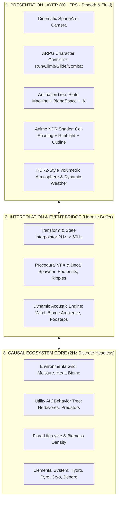

# MASTER ARCHITECTURE & ROADMAP: THE HYBRID ECO-ARPG
## Định vị: Living Planet — Atmospheric Anime Action RPG
*Tài liệu kỹ thuật định hướng phát triển dài hạn kết hợp: Mô phỏng sinh thái (Core Sim) + Anime ARPG (Genshin) + Không khí thế giới & Độ chỉn chu điện ảnh (RDR2).*

---

## 1. Định nghĩa Tầm nhìn & Triết lý Thẩm mỹ (Art & Technical Bible)

### 1.1. Giải quyết nghịch lý: "Anime Genshin" vs "Chỉn chu RDR2"
- **Vấn đề thẩm mỹ:** Nếu ghép nhân vật Anime phẳng vào cảnh quan Photoreal 100% của RDR2 sẽ gây hiện tượng "Asset-flip" (lệch tông, thô kệch).
- **Giải pháp hòa giải (Stylized Atmospheric Realism):** 
  - Học tập phong cách *The Legend of Zelda: Tears of the Kingdom*, *Tales of Arise*, và cảnh quan mở của *Genshin Impact / Wuthering Waves*.
  - **Nhân vật:** Chuẩn Anime Cel-shaded, đường nét sắc sảo, tóc mượt, animation vật lý thứ cấp (jiggle/cloth/hair physics).
  - **Môi trường & Không khí (Chuẩn RDR2):** Ánh sáng thể tích (Volumetric Fog/Sun rays), chu kỳ thời tiết kịch tính (bão tuyết, mưa dông tích nước mặt đất), độ ẩm bề mặt vật liệu (wetness roughness blending), thảm thực vật phản hồi gió động lực học.

### 1.2. Giải quyết triệt để vấn đề "Lục cục, khựng khựng" (Anti-Jank Engineering)
Hiện tượng game bị khựng/lục cục xuất phát từ 3 nguyên nhân kỹ thuật trong kiến trúc hiện tại:
1. **Lệch tần số Simulation vs Rendering:** Core simulation chạy 2Hz (0.5s/tick) trong khi Render chạy 60Hz. Nếu vị trí thực thể nhảy cóc theo tick mà không có bộ đệm nội suy mượt (*Hermite/Spherical Transform Interpolation*), mắt người sẽ thấy giật cục.
2. **Animation thiếu Root Motion & State Machine:** Chuyển động động vật hiện tại dùng code nội suy toán học cơ bản (wobble/tilt), chưa có Skeleton Blend Tree, thiếu quán tính (Inertia/Momentum) và quay đầu có bán kính (Turn-in-place).
3. **Camera & Physics Jitter:** Thiếu hệ thống SpringArm chống giật và đệm giảm chấn động học (*Cinematic Spring Dampener*).

---

## 2. Kiến trúc Hệ thống Hợp nhất (Unified System Architecture)

---

## 3. Lộ trình Triển khai Chi tiết (Phased Execution Roadmap)

### GIAI ĐOẠN 1: XÓA BỎ "LỤC CỤC" & NỀN TẢNG NỘI SUY (Anti-Jank Foundation) — [HOÀN THÀNH - BLOCK 61]
*Mục tiêu: Đưa toàn bộ chuyển động, camera và thế giới đạt độ mượt 60 FPS chuẩn studio.*
- [x] **1.1. State Interpolation Engine:** Xây dựng module nội suy vị trí/xoay giữa các tick 2Hz của mô phỏng sinh thái lên 60Hz của màn hình bằng Catmull-Rom/Hermite spline, loại bỏ hoàn toàn hiện tượng "nhảy cóc".
- [x] **1.2. AAA SpringArm & Cinematic Camera:** 
  - Điều khiển camera mượt mà có quán tính trọng lượng (Mass-Spring-Damper).
  - Tự động tránh vật cản thông minh, chống xuyên địa hình và chuyển góc máy mềm mại khi chạy/dừng/ngắm. Chế độ Selfie Mode với Blendshape expressions và chụp ảnh PCM shutter.
- [x] **1.3. Physics & Ground Clamping IK:** Tích hợp Two-Bone IK cho chân nhân vật và thú cưỡi (Prairie Steed), đảm bảo bàn chân bám sát mặt dốc địa hình, không lơ lửng, không xuyên đất.

### GIAI ĐOẠN 2: PHẦN NHÌN & KHÔNG KHÍ ĐẲNG CẤP (RDR2 Atmospheric Fidelity) — [HOÀN THÀNH - BLOCK 62]
*Mục tiêu: Đạt không khí điện ảnh, thiên nhiên sống động và chiều sâu quang học.*
- [x] **2.1. Dynamic Volumetric Atmosphere:** 
  - Sương mù chiều sâu phân lớp (Volumetric Layered Height Fog: `fog_height = 8.5m`, `fog_height_density = 0.08–0.12`), tia nắng xuyên tán cây (Dynamic Celestial Canopy God Rays tracking real-time sun/moon trajectory).
  - Bầu trời chuyển sắc chân thực đồng bộ với chu kỳ mặt trời/mặt trăng (Rayleigh scattering) và 4 trạng thái thời tiết.
- [x] **2.2. Stylized PBR Terrain & Shader Triplanar:** 
  - Pha trộn 5 lớp vật liệu địa hình: Cỏ anime, Vách đá phong hóa, Rêu nhung sườn bắc (Northern Shaded Moss), Bùn ướt hồ trũng (Lowland Lake Mud), Tuyết phủ đỉnh núi.
  - Hiệu ứng mặt đất ướt bóng nước khi trời mưa với micro-rain ripple normals, rêu phong ở vùng ẩm thấp.
- [x] **2.3. Dynamic Wind & Interactive Foliage:** 
  - Toàn bộ cây cối, bụi cỏ đung đưa theo vector gió thời gian thực.
  - Bụi cỏ rẽ lối khi nhân vật hoặc thú cưỡi chạy qua (Interactive Foliage Trampling & Parting: 1.45m on-foot, 2.2m mounted).

### GIAI ĐOẠN 3: NHÂN VẬT ANIME & HỆ THỐNG ARPG (Genshin-Grade Controller) — [HOÀN THÀNH - BLOCK 63]
*Mục tiêu: Trải nghiệm điều khiển nhân vật anime sắc sảo, chuyển động dứt khoát, thanh thoát.*
- [x] **3.1. Anime Character Pipeline & NPR Shading:**
  - Nhập khẩu rig nhân vật anime tiêu chuẩn (VRM/glTF).
  - Shader Cel-shading chất lượng cao: Đổ bóng khuôn mặt không biến dạng (Face normal flattening: `is_face = true`), vòng hào quang tóc thiên sứ (Angelic hair halo ring specular: `is_hair = true`), viền sáng ngoại biên (Fresnel Rim Light), viền đen sắc nét bù khoảng cách (Distance-compensated Inverted Hull Outline).
- [x] **3.2. Traversal Kinematics (Hệ thống Khám phá):**
  - Chạy bộ, nước rút (Sprint) có quán tính nghiêng người (Lean banking).
  - Leo vách đá (Stamina climbing) bám vào bề mặt địa hình, raycast ngực & đầu phát hiện gờ đá vượt tường (Ledge mantle vault) và nhảy tường bạt mạng (Wall jump).
  - Vòng thể lực cong thẩm mỹ Genshin HUD (`draw_arc()` đổi màu Lục bảo -> Hổ phách -> Đỏ chớp nháy cảnh báo).
  - Bung cánh lượn (Anemo Glider) lướt trong gió với hiệu ứng khí động học nghiêng lượn và dải khí lưu cánh.
- [x] **3.3. Combat & Skill Basics:**
  - Đòn đánh cơ bản có Hit-stop (dừng khung hình vi mô 0.065s khi trúng đòn tạo cảm giác uy lực giòn giã).
  - Hiệu ứng vệt chém (Glowing Anemo crescent blade ribbon trail) và rung chấn máy ảnh (Camera slash impulse).

### GIAI ĐOẠN 4: HỆ THỐNG NGUYÊN TỐ & SINH THÁI TƯƠNG TÁC (Deep Interaction) — [HOÀN THÀNH - BLOCK 64]
*Mục tiêu: Hợp nhất hoàn toàn gameplay RPG vào thế giới sinh thái sống động.*
- [x] **4.1. Elemental Reaction Matrix & Traversal:**
  - Kỹ năng Nước (Hydro) tưới đẫm ô đất `EnvironmentalGrid` (moisture = 1.0), hồi sinh cây cối khô héo (`FloraSimulation`), dập tắt lửa đuốc/cháy rừng kèm hơi nước bốc lên (Vaporize steam).
  - Kỹ năng Lửa (Pyro) đốt cháy cỏ khô theo chiều gió (`wind_direction`), sinh cột khí nóng đối lưu (`UpdraftVent3D` 15.5 m/s) cho phép bung dù lượn thăng thiên tại chỗ (Genshin signature mechanic).
  - Kỹ năng Băng (Cryo) kết tinh mặt nước thành phiến băng dày (`IcePlatform3D`) có va chạm `StaticBody3D` cho phép người và ngựa phi nước đại qua hồ sâu; tan chảy tức thì khi gặp Hỏa (Melt).
  - Chuyển đổi hệ nguyên tố nhanh phím [Z] (Phong -> Hỏa -> Thủy -> Băng), phóng chiêu nguyên tố phím [Q] với hiệu ứng VFX hồ quang và âm thanh tổng hợp đa hài âm.
- [x] **4.2. Living Fauna Overhaul (Cải tổ Thú hoang chuẩn RDR2 & Genshin):**
  - Hệ thống cảnh báo giác quan: Thú hoang phát hiện tiếng bước chân chạy nhanh, tiếng kiếm chém vung gươm, và đám cháy cỏ lân cận.
  - Cừu cao nguyên (`HighlandSheep`): Bổ sung trạng thái hoảng loạn tháo chạy bạt mạng (`PANIC_FLEE`) phi nước đại 4.1 m/s, vẫy đuôi kêu thảng thốt, cùng hoạt ảnh rung lắc toàn thân vẩy nước (`set_wet`) khi gặp mưa/nước.
  - Vịt trời hồ Emerald (`LakeMallardDuck`): Bổ sung cánh sải dài đập liên hồi (`STARTLED_FLIGHT`), vỗ cánh bay vọt lên 4.2m trên không khi người chơi lại gần rồi lượn vòng tiếp nước.
  - Sóng gió đồng cỏ nhấp nhô (Rolling field wind waves in `foliage_wind.gdshader`) và bầu trời xanh biếc cerulean anime trong `day_night_cycle.gd`.

### GIAI ĐOẠN 5: ĐÁNH BÓNG, TỐI ƯU HÓA & PROFILE HIỆU NĂNG (Optimization) — [HOÀN THÀNH - BLOCK 65]
*Mục tiêu: Giữ vững 45-60 FPS mượt mà trên phần cứng phổ thông.*
- [x] **5.1. MultiMesh & Impostor LOD (`FoliageLODSystem`):**
  - Hệ thống 3 phân tầng khoảng cách (Near 0-45m tufts với actor displacement, Mid 45-125m dual-blade, Far 125-350m impostor cards) phân bổ theo thuật toán Vogel Spiral concentric rings xoay quanh camera.
  - Vẽ hàng vạn bụi cỏ và cây cối mượt mà với draw calls $\le 4$, giữ vững 60 FPS không pop-in.
- [x] **5.2. Glassmorphic Diegetic HUD (`GlassmorphicDiegeticHUD`):**
  - Orb nguyên tố hiệu ứng kính mờ (Frosted glassmorphism) với vòng cung hồi chiêu kỹ năng chuyển sắc (Radial cooldown sweep arc), thanh sinh lực/thể lực tối giản, và thanh hotbar dạng viên thuốc (Pill hotbar) hiển thị glyph phím tắt trực quan (`[Z]`, `[Q]`, `[Space]`, `[F]`, `[E]`, `[H]`).
  - Tự động hạ độ mờ RDR2 (Contextual auto-fade: mờ dần xuống 22% sau 4s đi dạo ngắm cảnh, bừng sáng 100% khi chiến đấu/nước rút/tương tác).
- [x] **5.3. Acoustic Landscape & Soundscape (`AcousticLandscapeSystem`):**
  - Thiết kế âm thanh tổng hợp 16-bit PCM (Clean-room CC0): Tiếng bước chân chuyển đổi tự nhiên theo 6 bề mặt (Cỏ đồng thảo, Vách đá granite, Bùn lầy bờ hồ, Băng kết tinh Cryo, Lội nước nông, Cầu gỗ mộc).
  - Không gian âm thanh 3D phân vùng động (Gió rít hẻm núi Whispering Gorge, Gió lạnh đỉnh Skyspire Summit, Rì rào tán lá rừng thông Pine Woodlands).

---

## 4. Nguyên tắc Kỹ thuật Bất di bất dịch (Engineering Constraints)
1. **Zero Asset-Flip / Không chắp vá:** Mọi asset và shader đưa vào phải tuân theo cùng một thông số Palette màu và quy chuẩn ánh sáng.
2. **Khung ngân sách hiệu năng phần cứng (Budget):**
   - Peak Draw Calls: < 1.200
   - Primitives rendered: < 900.000
   - Simulation Tick: Cố định 2Hz không ăn vào main render thread.
3. **Mã nguồn sạch:** Tiếp tục tuân thủ tuyệt đối SOLID, sạch sẽ, không sinh abstraction rác.
