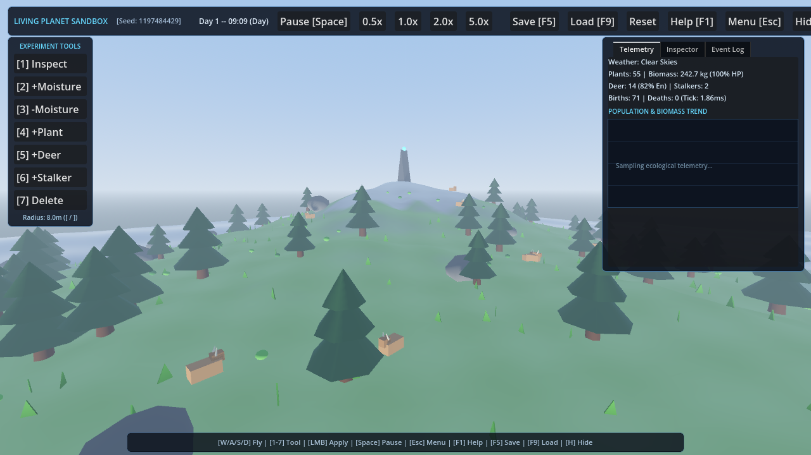
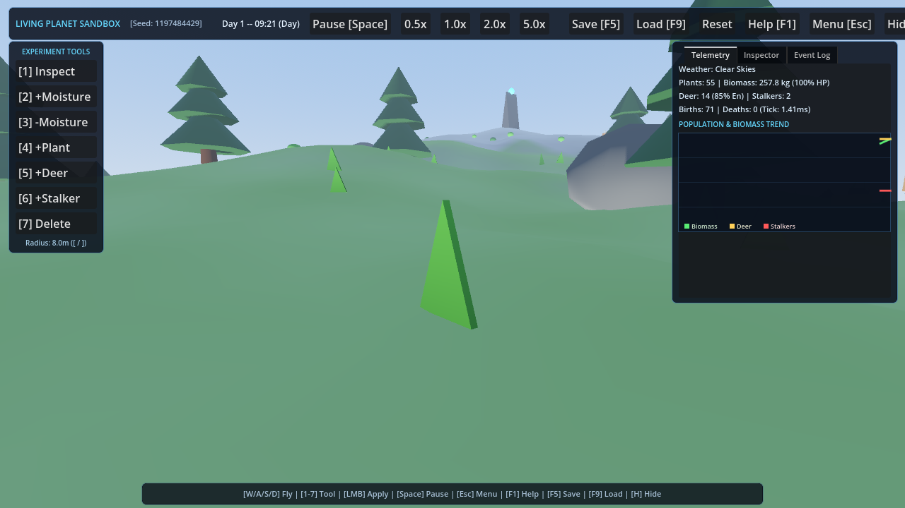
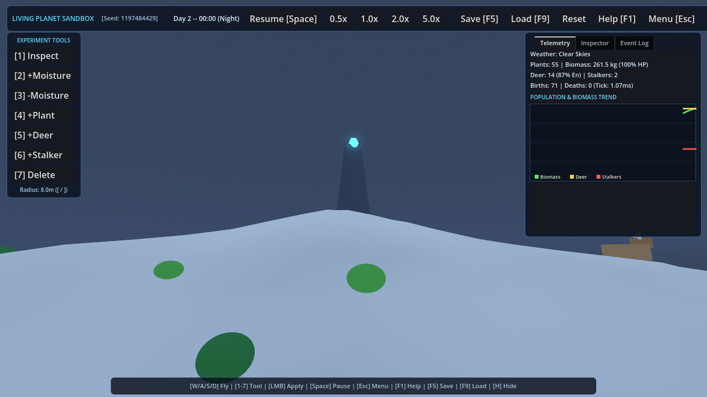
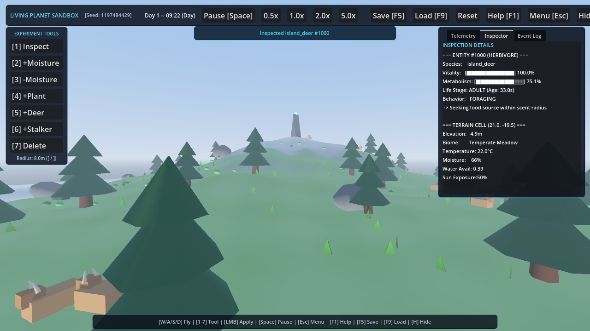
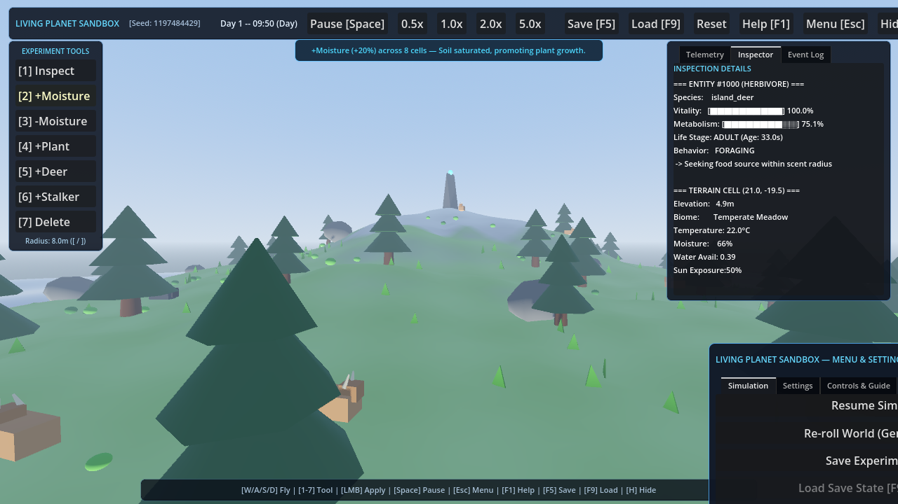

# Living Planet Sandbox 🌍🌱

> **A Solo 3D Ecosystem Sandbox built with Godot 4.6 (Forward+ Vulkan)**  
> *Observe, intervene, and understand causal ecological relationships across a living procedural island.*



---

## 🌟 Overview

**Living Planet Sandbox** is an offline-first 3D environmental simulation sandbox developed in Godot Engine 4.6.3 (GDScript). Players explore a bounded procedural island featuring dynamic terrain, Gerstner ocean waves, a diurnal day/night cycle, a 4-state Markov weather system, and interacting flora and fauna populations.

The core design philosophy is **authentic ecological causality**: changes in the world are not scripted visual effects, but emergent outcomes of continuous microclimate parameters (soil moisture, surface temperature, sunlight exposure), plant growth cycles, animal metabolisms, and trophic predator-prey dynamics.

---

## 🖼️ Gameplay & Runtime Showcase

| Scenic Island Overview | Close-up Shoreline & Foliage |
| :---: | :---: |
|  |  |

| Midnight Sky & Summit Monolith | Full Telemetry & Inspection HUD |
| :---: | :---: |
|  |  |

| Player Moisture Intervention Pulse | In-Engine Menu & Settings Modal |
| :---: | :---: |
|  |  |

---

## 🔬 Core Simulation Systems

### 1. Procedural World Generation & Biomes
- **Deterministic Island Geography:** Bounded 160m island generated using multi-frequency simplex noise with dedicated PRNG stream isolation. Identical seeds reproduce exact terrain, water boundaries, and flora placement.
- **Slope & Elevation Shading:** Procedural vertex-colored terrain blends steep cliffs ($>0.38$ slope) into weathered granite, shoreline elevations ($<1.1\text{m}$) into warm sand, and mountain peaks ($>12.0\text{m}$) into alpine snow.
- **Whittaker Biome Classification:** Discrete 32x32 macro grid (1024 cells) classifies 7 biomes: `OCEAN`, `COASTAL_BEACH`, `WETLAND`, `TEMPERATE_MEADOW`, `BOREAL_FOREST`, `ALPINE_SUMMIT`, `ARID_SHRUBLAND` with explainable rationale.

### 2. Microclimate & Dynamic Weather
- **Markov Chain Weather:** 4 discrete weather states (`CLEAR`, `CLOUDY`, `RAIN`, `DROUGHT`) governing solar attenuation, temperature offsets, and precipitation.
- **Continuous Environmental Fields:** Each cell tracks dynamic soil moisture $[0, 1]$, surface temperature (°C factoring solar angle and elevation lapse rate of $-6.5^\circ\text{C/km}$), and water availability.

### 3. Causal Flora & Fauna Simulation
- **Decoupled Discrete 2Hz Loop:** Simulation updates independently of render framerate, maintaining strict frame budgets on integrated graphics.
- **Flora Life Cycle:** Plants progress through `SEED`, `SPROUT`, `GROWING`, `MATURE`, `DECAYING`, and `DEAD`. Biomass growth requires adequate moisture and sunlight; moisture deficits cause drought decay and withering.
- **Herbivores (`island_deer`):** State machine managing `WANDERING`, `FORAGING`, `EATING`, `RESTING`, `FLEEING`, and `STARVING`. Herbivores graze on plant biomass to replenish energy, reproduce when well-fed, and perish if starved.
- **Apex Predators (`mountain_stalker`):** Stalk and hunt herbivores within scent radius, maintaining herd carrying capacity and preventing vegetation overgrazing.
- **Spatial Hash Partitioning:** 8x8 cell spatial grid enables $O(1)$ grazing and threat lookups.

### 4. Player Experiment Tools & Observability
- **3D Surface Cursor:** Dynamic torus brush indicator snaps to terrain with real-time radius scaling (`[ / ]`).
- **7 Sandbox Tools:**
  - `[1] Inspect`: Interrogate entity vitals (health, energy, biomass, metabolic state) or cell climate.
  - `[2] +Moisture`: Hydrate bounded region (+20% moisture brush).
  - `[3] -Moisture`: Induce localized drought (-20% moisture brush).
  - `[4] +Plant`: Seed new vegetation on viable dry ground.
  - `[5] +Deer`: Spawn herbivores on habitable terrain.
  - `[6] +Stalker`: Introduce apex predators to control population.
  - `[7] Delete`: Remove selected entity from simulation and registry.
- **Authentic Telemetry:** Real-time population and biomass trend chart rendered via native `Control._draw()` polylines over rolling history (zero mock data).
- **In-Engine Menu (`[Esc]`):** Glassmorphic modal providing simulation controls, seed re-rolling, functional display/fog settings, and keybinding guide.

### 5. Atomic Schema v2 Persistence
- **Crash-Safe Serialization:** Writes save states to `<path>.tmp`, rotates previous save to `<path>.bak`, and promotes via atomic rename.
- **Self-Healing:** Automatically falls back to `.bak` if primary JSON is corrupted or invalid.

---

## 🎮 Controls & Shortcuts

| Action | Primary Input | Secondary / Alternative |
| :--- | :--- | :--- |
| **Move Camera** | `W / A / S / D` | Arrow Keys |
| **Altitude Up / Down** | `Space` / `C` | `E` / `Q` |
| **Flight Speed Boost** | `Shift` (Hold) | — |
| **Adjust Flight Speed** | `Mouse Wheel Up / Down` | Flight Slider in Settings |
| **Look / Rotate View** | `Right Mouse Button` (Hold + Drag) | Middle Mouse Button |
| **Select Tool [1 - 7]** | Number Keys `1` to `7` | Click Tool Palette in HUD |
| **Apply Tool** | `Left Mouse Button` | — |
| **Adjust Brush Radius** | `[` (Decrease) / `]` (Increase) | — |
| **Toggle Menu & Settings** | `Escape` | `Menu [Esc]` Button in HUD |
| **Toggle Help & Guide** | `F1` | `Help [F1]` Button in HUD |
| **QuickSave Experiment** | `F5` | Simulation Menu Tab |
| **QuickLoad Experiment** | `F9` | Simulation Menu Tab |
| **Pause / Resume** | `Space` (when not flying) | Top Toolbar Button |
| **Toggle HUD Visibility** | `H` | Top Toolbar Button |

---

## 💻 System Requirements

Living Planet Sandbox is engineered and measured specifically for thin-and-light laptop hardware without discrete GPUs:

| Component | Minimum Specification | Recommended Specification |
| :--- | :--- | :--- |
| **Operating System** | Windows 10/11 (64-bit) | Windows 11 (64-bit) |
| **Processor** | Intel Core i5 11th Gen / AMD Ryzen 5 4000 | Intel Core i7 11th/12th Gen or higher |
| **Memory (RAM)** | 8 GB RAM | 16 GB RAM |
| **Graphics** | Intel Iris Xe Graphics (or AMD Radeon Vega) | Intel Iris Xe Graphics (96 EUs) |
| **Vulkan Support** | Vulkan 1.2+ Compatible Driver | Vulkan 1.4 Compatible Driver |
| **Storage** | 250 MB free space | 500 MB free space |

### Measured Target Hardware Baseline (Intel Iris Xe Integrated GPU):
- **Average Framerate:** 30.8 – 41.5 FPS at $1280 \times 720$ Windowed (Vulkan Forward+)
- **Draw Calls:** Peak 1,009 calls (well below 1,500 target budget)
- **Rendered Primitives:** 822,834 vertices (reduced by 40.2% via shadow clamping)
- **p95 Frame Time:** 47.24 ms
- **Simulation Step Overhead:** 1.24 ms at 2Hz tick rate

---

## 🚀 Building & Running

### Option A: Running Standalone Release Package
1. Navigate to the release directory:
   ```powershell
   build\release\LivingPlanetSandbox.exe
   ```
2. The game will launch immediately into the procedural sandbox.

### Option B: Running from Source (Godot Editor)
1. Ensure **Godot Engine 4.6.3 (Standard 64-bit)** is installed.
2. Launch Godot and import `project.godot` located in the repository root:
   ```powershell
   godot --path .
   ```
3. Press `F5` to play the default scene (`res://scenes/main.tscn`).

---

## 🧪 Testing & Verification

The project includes an automated contract test suite with **100% pass rate** across 11 test suites (45 tests total):

```powershell
# Run all automated unit and contract tests (Headless)
cmd.exe /c "godot --headless --script res://tests/test_runner.gd"

# Run release candidate smoke test
cmd.exe /c "godot --headless --script res://tests/test_release_smoke.gd"

# Run reproducible multi-tier hardware benchmark
cmd.exe /c "godot --script res://tests/benchmark_suite.gd -- --target"

# Capture fresh runtime visual QA screenshots
cmd.exe /c "godot --script res://tests/visual_qa_capture.gd"
```

### Test Suite Coverage:
- `WorldSeed`: PRNG determinism & isolated child streams
- `WorldClock`: Discrete time advancement, dilation, pause
- `WorldEventBus`: Pub/sub event isolation & signal delivery
- `EntityRegistry`: ID sequencing, component storage, despawn
- `WorldPersistence`: Schema v2 serialization & `.bak` atomic recovery
- `TestPlayableWorld`: Procedural terrain elevation, water plane, vegetation scatter
- `TestEnvironmentSystems`: World config validation, environmental grid, diurnal cycle, Markov weather, Whittaker biomes
- `TestCausalEcosystem`: Flora growth/decay, herbivore metabolism, predator hunting, paired causal drought experiment
- `TestExperimentToolsAndPersistence`: Tool interventions, atomic save rotation, clean world reset
- `TestStabilityAndRegression`: 50 rapid pause cycles, 5 repeated save/load cycles, 10 rapid resets, desert collapse, 200 carrying capacity cap
- `TestVisualPolishAndUX`: In-engine menu modal toggle & tabs, camera ground clearance, inspector vitals formatting, selection highlight ring, tool pulse lifecycles

---

## 📦 Creating a Windows Release Build

To export the Windows standalone executable:

```powershell
# Ensure export directory exists
if (-not (Test-Path "build\release")) { New-Item -ItemType Directory -Path "build\release" }

# Export release executable (embedded PCK)
godot --headless --export-release Windows_Desktop build\release\LivingPlanetSandbox.exe
```

The resulting standalone executable (`LivingPlanetSandbox.exe`) contains all embedded scripts, shaders, and configs with zero external asset dependencies.

---

## ⚠️ Known Limitations

1. **Integrated GPU Fill-rate:** At 1080p Fullscreen, high-frequency water vertex displacement may reduce framerates from ~41 FPS to ~26 FPS on older integrated GPUs. The default resolution is locked to $1280 \times 720$ Windowed for optimal performance.
2. **Procedural Meshes:** All fauna and flora are currently procedural low-poly primitive compositions (no rigged skeletal meshes). This is an intentional architectural decision to ensure zero third-party asset licensing contamination and low GPU draw overhead.
3. **Save Compatibility:** Schema v2 saves are fully backward compatible with Schema v1 files; however, Schema v1 saves will initialize missing microclimate variables with default regional averages.

---

## 📄 License & Attribution

- **Living Planet Sandbox Engine & Scripts:** Released under the [MIT License](LICENSE).
- **Godot Engine:** Copyright (c) 2014-present Godot Engine contributors; Copyright (c) 2007-2014 Juan Linietsky, Ariel Manzur. Licensed under the [MIT License](https://godotengine.org/license).
- **Water Shader:** Adapted from `LesusX/Water-Shader` under the [MIT License](https://github.com/LesusX/Water-Shader).
- **FastNoiseLite:** Embedded in Godot Engine core (Auburn/FastNoiseLite) under the [MIT License](https://github.com/Auburn/FastNoiseLite).
- **OpenAcre Project:** Architectural design reference for atomic save patterns under clean-room GDScript implementation (no GPL code incorporated).

See [THIRD_PARTY_COMPONENTS.md](THIRD_PARTY_COMPONENTS.md) for the complete license manifest and attribution breakdown.
